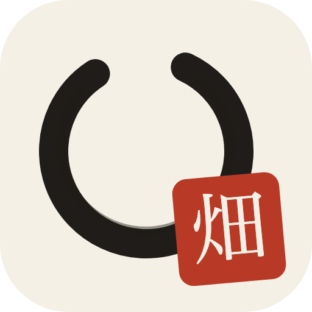

<div align="center">



# Uchibatake · うちばたけ

### Our family's field.

Grow a little food for the people you love — on a balcony, a windowsill, a rack in the hallway, a backyard or a
greenhouse. A calm, local-first PWA for beginners: the app is a patient grandparent beside you. Your field lives
on your phone; nothing needs an account to work.

[](https://vercel.com/new/clone?repository-url=https://github.com/hari2309s/uchibatake&root-directory=apps/web)


-3ECF8E?logo=supabase&logoColor=white)


</div>

---

## What works today

- **Sign in or explore** — Google or an email link (Supabase), or explore without an account: start your own
  field on this phone, or look around a demo family's field (Sam & Rosie in De Pijp, Amsterdam). A guest's field
  moves into their account when they sign in.
- **Onboarding** — where you'll grow, how much sun, where you are (town search or "use my location", named
  from your rough area, with the weather now and your climate from 30 years of history), who you grow for, how
  experienced you are, and a first-season plan of gentle plants that can start now.
- **Home** — the local season ("Late autumn · first frosts") with Japan's microseason beneath, the weather and
  what it means today, frost / heat / rain notices, today's small jobs, your spaces and what's ready soon.
- **Spaces** — add a balcony, windowsill, rack, backyard or greenhouse (ensō compass, three-times sun check,
  size); each space shows what grows there and what it's good for now, spring and summer.
- **Plants** — search, grow guides (facts in everyday words, the month strip for your place, neighbours as
  gardeners' tradition), how-to steps, start / where and when / first three steps, edit, timeline, log a
  harvest (the 収 stamp), end of season, and when a plant doesn't make it.
- **Journal** — pages with seals (済 収 種 芽), the seed box, and "Our year in the field" with a share card drawn
  on the phone.
- **Family** — roles, small jobs, who helped this week, and a kid view where children stamp their own 済.
- **Weather & seasons** — a seven-day forecast, "This week's sky", and the growing-year ring (local seasons
  outside, the 72 microseasons within).

Still to come: rack / grow-light / greenhouse details, plant diagnosis, recipes, PWA install and offline shell,
notifications, settings and export, and opt-in sync between phones.

## Run it

Needs Node 22+ and pnpm 10.

```sh
pnpm install
pnpm dev            # http://localhost:3000
```

Without any keys the app works fully as a guest or the demo. To turn on sign-in, add a `.env.local` at the
**repo root** (see `.env.example`; it's loaded for the web app by `next.config.ts`):

```sh
NEXT_PUBLIC_SUPABASE_URL=https://<project-ref>.supabase.co
NEXT_PUBLIC_SUPABASE_PUBLISHABLE_KEY=<publishable or anon key>
# Later, for plant diagnosis (server-side only):
GROQ_API_KEY=
OPENROUTER_API_KEY=
```

Supabase (Authentication › URL Configuration): set the **Site URL** to your deployed address and add
`<your address>/auth/callback` (and `http://localhost:3000/auth/callback`) to **Redirect URLs**, or sign-in falls
back to localhost. Turn on the **Google** provider with an OAuth client whose redirect URI is
`https://<project-ref>.supabase.co/auth/v1/callback`. No database tables are needed yet.

Vercel: set the root directory to `apps/web`, add the two `NEXT_PUBLIC_SUPABASE_*` variables, and
`ENABLE_EXPERIMENTAL_COREPACK=1` so the pinned pnpm is used.

## Scripts

| Script | What it does |
|---|---|
| `pnpm dev` | The web app in development |
| `pnpm build` / `pnpm start` | Production build and server |
| `pnpm lint` · `pnpm typecheck` | ESLint · TypeScript, across the workspace |
| `pnpm check` | Lint, typecheck and build in one go |
| `pnpm test` | Unit tests (content package and web) |
| `pnpm e2e:install` · `pnpm test:e2e` | Install Playwright's browser · browser tests (phone and desktop, light and dark; build first) |

## Where your data goes

- Your field lives **on your device** (IndexedDB), one database per person. Signing in doesn't upload it; sharing
  between phones is a later, opt-in step.
- Your location is rounded to about a kilometre before it's used: to name your neighbourhood (OpenStreetMap),
  fetch the weather and your climate history (Open-Meteo). It isn't stored on any server.
- The share card is drawn on your phone; nothing is uploaded.

## Layout

```
apps/web/              Next.js app (App Router)
  src/app/             routes: (app)/ screens, sign-in, start/ onboarding, auth/callback, dev/kit
  src/components/ui/   Washi & Sumi primitives (ensō, seals, notices, sheet, step view…)
  src/components/      screens, onboarding, auth
  src/lib/             data layer (Dexie repo, hooks, provider), weather, seasons, plans, rules
packages/content/      curated, sourced content: crops (RHS), the 72 microseasons, local seasons
```

Growing advice comes only from curated data with sources (each crop cites its pages); when we don't know, the
app says less. Companion pairs are marked as gardeners' tradition.

## Design

The Washi & Sumi designs live in `design_export/washi-sumi/` (kept locally, never committed). `CLAUDE.md` has
the design system, the season rules and the project rules; `/dev/kit` shows every primitive in light and dark.
